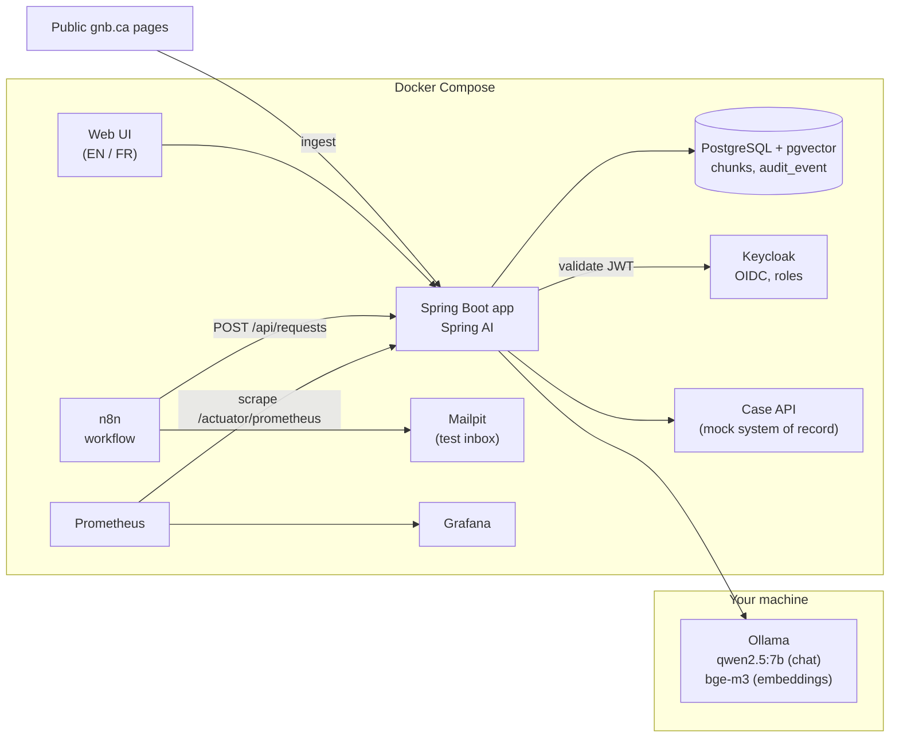
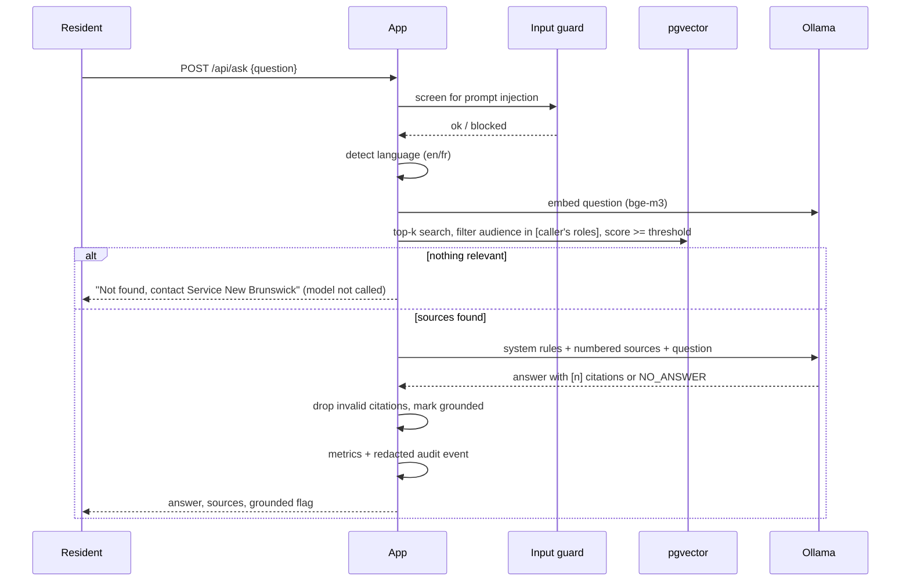
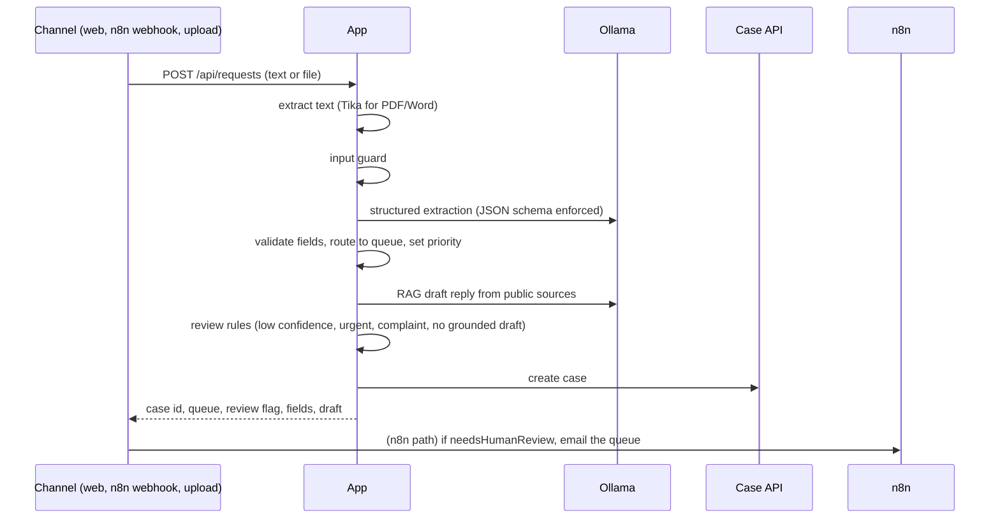

# Architecture

## Components

## Flow 1: answering a question (RAG with citations)

## Flow 2: intake workflow (document processing and automation)

## Data model

- `vector_store` (created by Spring AI): chunk text, embedding (1024 dims, HNSW, cosine), metadata
  `source_id, title, url, lang, audience, topic, chunk, ingested_at`.
- `audit_event`: `occurred_at, actor, action, outcome, detail` (detail is redacted before insert).

## Trust boundaries

| Boundary | Control |
|---|---|
| Resident input to model | Pattern guard, input fenced as data in the prompt, model has no tools |
| Retrieved text to model | Fenced as `<sources>`, rule to ignore instructions inside sources |
| Staff-only knowledge | Audience filter applied inside the vector query, not after generation |
| Model output to resident | Citations validated, uncited answers flagged, intake drafts go to a person first |
| Logs and audit | PII redaction at the boundary |
| Model hosting | Local Ollama: prompts and documents never leave the machine |
